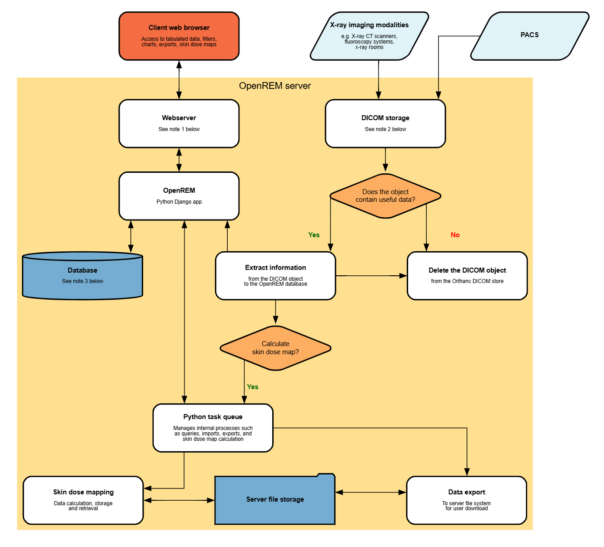

Diagram of system components
============================

Alternatives
------------

1: Web servers
^^^^^^^^^^^^^^
The recommended web server for Windows is Microsoft IIS. See :doc:`install_windows` for details.

The recommended web server for Linux is Gunicorn with NGINX - see :ref:`Install Linux webserver` for details.

Alternatively, a built-in web server is included that will suffice for testing purposes and getting started.

2: DICOM Store node
^^^^^^^^^^^^^^^^^^^
Any DICOM Store can be used, as long as it can be used to call the OpenREM import script. See :doc:`netdicom-nodes` for
more details. Orthanc is the recommended DICOM Store services to use; it is installed by default in Docker, see
:ref:`dicom_store_scp_linux` for Linux installation, *to be written* for Windows installation, and the
:ref:`configure_third_party_DICOM` section for configuration help.

3: Database
^^^^^^^^^^^
PostgreSQL is the recommended database to use with OpenREM. It is the only database that OpenREM will calculate
median values for charts with. Other databases can be used with varying capabilities; see the `Django documentation
<https://docs.djangoproject.com/en/3.2/ref/databases/>`_ for more details. For testing only, the built-in SQLite3
database can be used, but this is not suitable for later migration to a production database.
